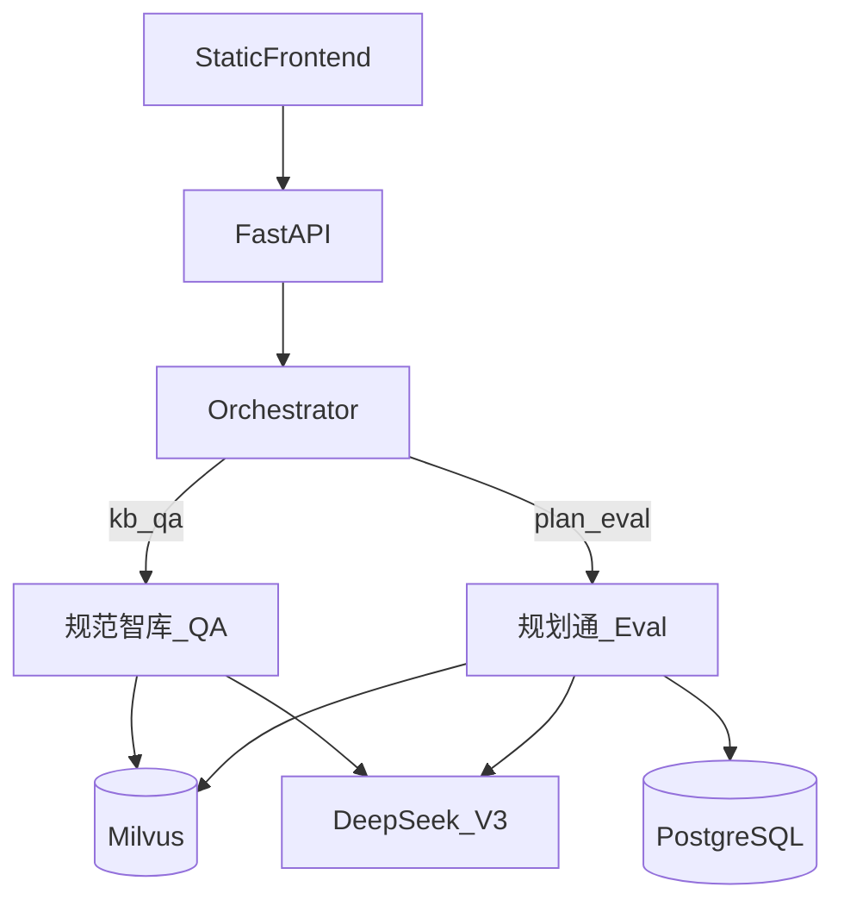

# 规划方案助手——多 Agent 智能体平台

当前版本：**[v1.0.0](CHANGELOG.md)**  
作品预览（GitHub Pages）：https://haha-go.github.io/landscape-planning-agent/

面向规划设计场景的 **多 Agent 智能体平台**：
统一对话入口，按意图分流到规范问答或方案审核，并支持系统初审 + 人工终审闭环。

工程目录：`Landscape_Planning_Agent`  
详细架构与 API 规格 → [docs/ARCHITECTURE.md](docs/ARCHITECTURE.md)

---

## 双产品

| 产品 | 定位 | 核心能力 |
|------|------|----------|
| **规划通** | 规划方案智能审核 Agent 平台 | PDF 结构化抽取 → 五维并行评分 → 加权总分与问题清单 → 可选人工认领 / 改分 / 终审 |
| **规范智库** | 专业规范可溯源智能问答系统 | 意图分类 → 直答或 RAG 检索生成 → SSE 流式输出 → 正文引用高亮 + 底部正式标号 |

三档模式：`自动` / `规范智库` / `规划通`（请求字段 `agent_mode`：`auto` | `kb` | `plan`）。

---

## 亮点

- **多 Agent 编排**：规则 Orchestrator 路由到 QA / Eval 子图（LangGraph），避免单体巨型图
- **可溯源 RAG**：BGE-M3 稠密 + 稀疏 → Milvus RRF → 可选精排；引用清洗与正式 GB/CJJ 标号展示
- **人机协同审核**：系统分与人工分并存；JWT + RBAC；认领 / 改派 / 审计 / 报表
- **工程可复现**：单测 + `evals/` 金标题集 + 试点结果快照（见下方成效摘要）

---

## 架构总览



| 层 | 选型 |
|----|------|
| 语言 | Python 3.11（异步） |
| Web | FastAPI + SSE + 静态前端挂载 |
| Agent | LangChain 1.2.x + LangGraph 1.0.x |
| LLM | DeepSeek-V3（OpenAI 兼容） |
| 向量库 | Milvus 2.4（`landscape_kb`，dim 1024） |
| 关系库 | PostgreSQL 15 |
| 本地模型 | BGE-M3 / BGE-Reranker / MiniLM（仓库根 `models/`，不入库） |

---

## 目录结构

```text
├── backend/           # FastAPI、Agents、RAG、服务层
│   ├── agents/        # orchestrator / qa / eval
│   ├── api/v1/        # HTTP 路由
│   ├── rag/           # 嵌入、检索、精排、入库
│   └── parsers/       # PDF 解析
├── frontend/          # 静态对话 UI + 审核工作台
├── knowledge_base/    # 脱敏规范语料（standards）与样例
├── scripts/           # DB/Milvus 初始化、入库、评测脚本
├── evals/             # 规范智库 / 规划通 金标与试点结果
├── tests/             # 路由、QA、审核、指标等单测
├── docs/ARCHITECTURE.md
├── docker-compose.yml
└── requirements.txt
```

---

## 快速启动

### 前置

1. Python 3.11 + 依赖：`pip install -r requirements.txt`
2. 复制环境变量：`cp .env.example .env.local`，填入 DeepSeek API Key 等（**勿提交** `.env.local`）
3. 准备本地模型权重到仓库根目录 `models/`（BGE-M3 / Reranker / MiniLM；体积较大，已在 `.gitignore`）
4. Docker（Postgres + Milvus 等）

### 启动顺序

```bash
# 1. 基础设施
docker compose --env-file .env.local up -d

# 2. Milvus collection
python scripts/init_milvus.py

# 3. 脱敏规范入库
python scripts/ingest_kb.py knowledge_base/standards

# 4. API + 前端
python -m uvicorn backend.main:app --host 0.0.0.0 --port 8000
```

浏览器打开 `http://127.0.0.1:8000`；OpenAPI：`http://127.0.0.1:8000/docs`。

### 演示账号（仅本地联调）

| 角色 | 用户名 | 密码 |
|------|--------|------|
| 提交人 | `submitter` | `submitter123` |
| 审核员 | `reviewer` | `reviewer123` |
| 管理员 | `admin` | `admin123` |

规范智库可匿名提问；上传方案 PDF 须登录。生产环境必须更换 `JWT_SECRET` 与账号。

---

## 成效摘要

规范智库与规划通题集、指标分开统计。完整口径与复跑方式见 [docs/ARCHITECTURE.md](docs/ARCHITECTURE.md) §9 与 `evals/*/README.md`。

### 规范智库

| 指标 | 门槛 |
|------|------|
| 意图准确率 | ≥ 95% |
| 检索增强命中率（standards） | ≥ 90% |
| 引用准确率 | ≥ 95% |
| 幻觉率 | < 3% |
| RAG 首 token P95 | < 3s |

### 规划通试点（2026-10-15，n=10）

数据：`evals/plan/results/20261015_pilot/pilot.json`

| 指标 | 实测 | 目标 |
|------|------|------|
| 初审耗时降幅 | 99.7% | ≥ 50% |
| 复核工作量降幅 | 58.0% | ≥ 50% |
| 周期缩短 | 68.7% | ≥ 60% |
| Token 降幅 | 50.0% | ≥ 25% |
| 平均绝对改分差 | 2.50 分 | 报告即可 |

说明：试点 PDF 为生成短稿；对外引用真实脱敏方案时应复跑更新。

---

## 更多文档

| 文档 | 内容 |
|------|------|
| [docs/ARCHITECTURE.md](docs/ARCHITECTURE.md) | 角色权限、状态机、Agent 流水线、数据模型、API、部署联调 |
| [evals/kb/README.md](evals/kb/README.md) | 规范智库评测套件 |
| [evals/plan/README.md](evals/plan/README.md) | 规划通试点与 Token 对照 |
| OpenAPI `/docs` | 在线接口文档 |
