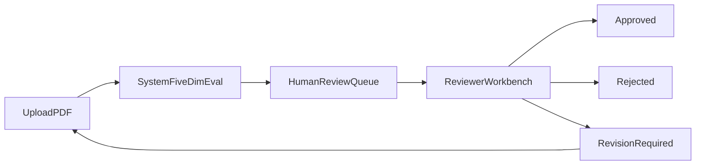
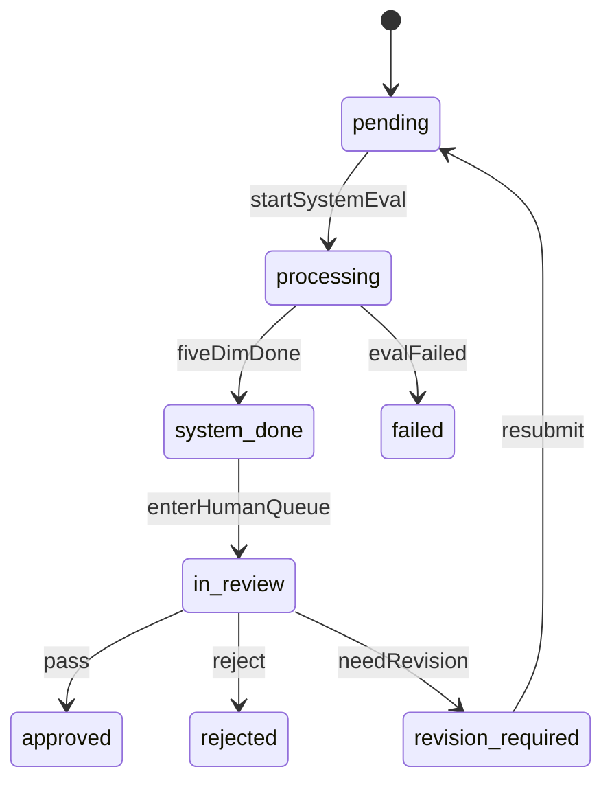
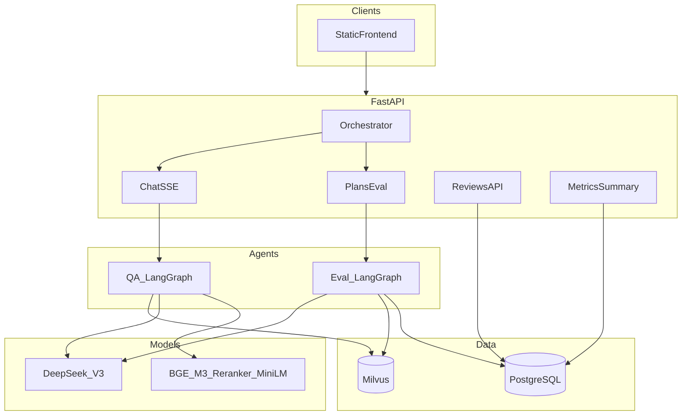

# 规划方案助手 — 架构与技术规格

> 多 Agent 智能体平台技术设计。求职向总览见根目录 [README.md](../README.md)。  
> 工程目录名：`Landscape_Planning_Agent`。

---

## 1. 产品与角色

### 1.1 双产品

| 产品 | 模式码 | 能力 |
|------|--------|------|
| **规范智库** | `kb` | 专业规范可溯源智能问答（意图分流 + RAG + SSE 引用） |
| **规划通** | `plan` | 规划方案智能审核（PDF 抽取 → 五维评分 → 人机终审） |

统一入口：主窗口对话 + 三档 Agent（`auto` / `kb` / `plan`）。编排者按 `agent_mode` 与意图路由到问答或评估。

### 1.2 目标用户

| 角色 | 诉求 |
|------|------|
| 方案提交人 | 上传 PDF、查看系统评分与问题清单、按意见修改后重提 |
| 审核员 | 领取队列任务、对照系统依据改分或批注意见、给出结论 |
| 管理员 / 终审员 | 分配任务、查看审计、配置权重与知识库 |
| 业务咨询用户 | 通过对话查询规范、绿地指标、规划常识（RAG） |

### 1.3 角色与权限

最小 JWT（`POST /api/v1/auth/login`）。本地联调账号见 [README.md](../README.md)。生产环境必须更换 `JWT_SECRET` 与用户目录。

| 角色 | 编码 | 权限 |
|------|------|------|
| 提交人 | `submitter` | 登录后上传 PDF；勾选是否人工评审；查看「我的方案」；不可操作审核工作台 |
| 审核员 | `reviewer` | 审核队列、认领、改分、批注、提交 decision（仅 `in_review`） |
| 管理员 | `admin` | 同审核员 + 改派；查看全部方案 |
| 系统 | `system` | 执行评估流水线、写 `plan_reviews` 系统字段（无人工登录） |

说明：

- 规范智库问答可匿名；**规划通上传 PDF 必须登录**（任意三角色均可上传，写入 `submitter_id`）。
- `needs_human_review=true` → 评估成功进入 `in_review`；`false` → `system_only`（不入认领队列）。
- `default_tenant_id`（`backend/config.py`）为多租户预留；当前单租户 + JWT。

---

## 2. 业务主流程



1. 提交人登录后在主对话附带 PDF（勾选是否人工评审），或调用 `POST /api/v1/plans/evaluate` / `POST /api/v1/assistant`（须 Bearer）。
2. 系统解析文本 → 结构化抽取 → 五维并行评分 → 加权总分与摘要。
3. 评估成功：`status=done`；若需人工则 `review_status=in_review`，否则 `system_only`。系统分写入 `scores` / `overall_score`，不被人工覆盖。失败则 `failed`。
4. 审核员仅对 `in_review` 认领 / 改分 → `approved` / `rejected` / `revision_required`。
5. 退回修改后，提交人修改方案并重新上传，重新走系统评估。

### 2.1 人机协同状态机

`review_status` 表达业务态；`status` 表示任务执行态（`pending|processing|done|failed`）。



| `review_status` | 含义 |
|-----------------|------|
| `pending` | 已建单，等待系统评估 |
| `processing` | 系统评估进行中 |
| `system_done` | 系统评估完成，待入队（内部过渡态） |
| `in_review` | 人工审核中（需 `needs_human_review=true`） |
| `system_only` | 仅系统评估，不入认领队列 |
| `approved` | 终审通过 |
| `rejected` | 终审驳回 |
| `revision_required` | 退回修改 |
| `failed` | 系统评估失败 |

---

## 3. 系统架构



| 层 | 选型 |
|----|------|
| 语言 | Python 3.11（全异步） |
| Web | FastAPI + SSE + 静态前端挂载 |
| Agent | LangChain 1.2.x + LangGraph 1.0.x |
| LLM | DeepSeek-V3（OpenAI 兼容 API） |
| 向量库 | Milvus 2.4（collection `landscape_kb`，dense dim 1024） |
| 关系库 | PostgreSQL 15 |
| 本地模型 | BGE-M3 / BGE-Reranker / MiniLM（仓库根目录 `models/`，进程内） |

关键路径：

- 入口：`backend/main.py`
- 配置：`backend/config.py`、`.env.local`（勿提交；模板见 `.env.example`）
- 依赖注入 / DB：`backend/dependencies.py`

### 3.1 功能模块

| 模块 | 说明 | 代码位置 |
|------|------|----------|
| Orchestrator | `agent_mode` + 规则路由 `qa` / `eval` / `other` | `backend/agents/orchestrator/graph.py` |
| 规范智库（QA） | 意图分类 → 直答或检索+生成；SSE；引用清洗 | `backend/agents/qa/graph.py`、`backend/rag/` |
| 规划通（Eval） | PDF 解析 → 抽取 → 五维评分 → 汇总落库 | `backend/agents/eval/`、`backend/parsers/pdf.py` |
| HTTP API | health / chat / plans / assistant / reviews / metrics | `backend/api/v1/` |
| 静态前端 | 三档 Agent；「我的方案」/ 审核工作台 | `frontend/` |
| 基础设施 | Postgres、Milvus、etcd、MinIO、Attu | `docker-compose.yml` |
| 知识库入库 | MD/PDF 切块、BGE-M3 稠密+稀疏、RRF、精排 | `scripts/ingest_kb.py`、`backend/rag/ingest.py` |

人工终审：JWT/RBAC、认领/改派、`human_scores` 不覆盖系统分、`review_actions` 审计、报表 API、审核工作台 UI。

---

## 4. Agent 设计

### 4.1 Orchestrator

规则优先（非 LangGraph）。产品 Agent：**规范智库**（`kb`）与 **规划通**（`plan`）。

| mode | 行为 |
|------|------|
| `auto`（默认） | 带文件 → `eval`（规划通）；评估话术无文件 → `other`（引导上传）；其余 → `qa`（规范智库） |
| `kb` | 强制 `qa`；若带文件 → `other`（提示切到规划通/自动） |
| `plan` | 有文件 → `eval`；无文件 → `other`（上传引导） |

响应附带 `agent` / `agent_label` / `mode` / `reason`。API 层按路由调用子图，编排不进单一巨型图。

### 4.2 规范智库（QA）

```text
intent(MiniLM) → direct_answer | retrieve → generate
```

- 流式事件：`route` / `citation` / `token` / `done` / `error`
- 检索为空：`direct_no_hit`（通用建议，不编造规范）；可观测，不回写为 `direct`
- 引用出站 `snippet` ≤200；清洗教学免责句；教学标号映射为正式号
- 前端：正文高亮规范名 / 条款 / `[n]`；底部「参考规范」仅列正文实际引用的正式标号（无页码）
- 阈值：`intent_retrieve_threshold` 默认 `0.45`；`rag_top_k=20`，精排后 `rag_rerank_top_n=5`

#### 知识库语料

`knowledge_base/standards/`（教学合成条款，**非官方原文**）。`manifest.json` 提供展示用正式标号：

| 标题 | 展示用正式标号 |
|------|----------------|
| 城市绿地分类标准 | CJJ/T 85-2017 |
| 城市居住区规划设计标准 | GB 50180-2018 |
| 公园设计规范 | GB 51192-2016 |
| 海绵城市建设评价标准 | GB/T 51345-2018 |

### 4.3 规划通（Eval）

```text
parse_pdf → extract(structured) → fan-out score_dimension ×5 → aggregate
```

- PDF：PyMuPDF 抽文本；过短（<50 字）判失败；**不做 OCR**
- 合规维度：额外 RAG 检索规范条文辅助打分
- 摘要 ≤120 字、问题清单最多 20 条；分数 0–100
- 重试在单次模型调用；某一维失败只写该维 `error`；合规检索失败时该维仍打分

### 4.4 五维与权重

| 键 | 中文 | 默认权重 |
|----|------|----------|
| `planning_concept` | 规划理念 | 0.2 |
| `compliance` | 规范符合性 | 0.2 |
| `ecology` | 生态可持续 | 0.2 |
| `layout` | 功能布局 | 0.2 |
| `economy` | 经济可行性与运营管理 | 0.2 |

单维：`score`、`evidence[]`、`risks[]`、`suggestions[]`。抽取结构见 `backend/agents/eval/schemas.py`。

---

## 5. 数据模型

脚本：`scripts/init_db.sql`；启动幂等迁移：`backend/db/migrations.py`。

### 5.1 核心表

`qa_sessions` **/** `qa_messages`：会话与消息；`route` ∈ `direct|retrieve|direct_no_hit|other`；`citations` / `metrics` JSONB。

`plan_reviews`：

| 列 | 说明 |
|----|------|
| `id` | UUID PK |
| `file_path` / `file_name` | 上传文件 |
| `extracted_data` | 抽取 JSONB |
| `scores` / `overall_score` | 系统五维与加权总分 |
| `summary` / `issues` | 摘要与问题清单 |
| `status` | `pending\|processing\|done\|failed` |
| `review_status` | 见 §2.1 |
| `submitter_id` / `assignee_id` | 提交人 / 审核员 |
| `needs_human_review` | 是否入人工队列 |
| `human_scores` / `human_overall` / `human_comment` | 人工分与意见 |
| `final_decision` / `decided_at` / `decided_by` | 终审 |

系统评估成功后：`status=done` → `system_done` → `in_review`（或 `system_only`）。系统分不被人工覆盖。

`review_assignments`：认领关系（`active|released|done`）。

`review_actions`：审计（`claim|assign|override_score|approve|reject|request_revision` 等）。

`kb_documents`：知识库文档元数据。

**Milvus** `landscape_kb`：`text`、`dense`(1024)、`sparse`、`doc_id`、`title`、`section`、`page`、`standard_code`。

---

## 6. API 规格

OpenAPI：`http://127.0.0.1:8000/docs`。

### 6.1 核心接口

| 方法 | 路径 | 鉴权 | 说明 |
|------|------|------|------|
| `POST` | `/api/v1/auth/login` | 否 | 本地三角色 JWT |
| `GET` | `/api/v1/health` | 否 | Postgres / Milvus / 模型加载标志 |
| `POST` | `/api/v1/chat/stream` | 否 | JSON → SSE（无文件兼容） |
| `POST` | `/api/v1/assistant` | 评估须登录 | multipart：`message` + 可选 PDF + `agent_mode` + `needs_human_review` |
| `POST` | `/api/v1/plans/evaluate` | 是 | 上传 PDF → 同步五维结果 |
| `GET` | `/api/v1/plans/mine` | 是 | 当前用户上传列表 |
| `GET` | `/api/v1/plans/{review_id}` | 是 | 提交人仅本人；专家全部 |

`agent_mode`：`auto` | `kb` | `plan`。SSE：`orchestrator` / `route` / `citation` / `token` / `done` / `error`。

### 6.2 人工审核

前缀 `/api/v1/reviews`，需 `reviewer` 或 `admin`。

| 方法 | 路径 | 说明 |
|------|------|------|
| `GET` | `/api/v1/reviews` | 队列分页（默认 `in_review`） |
| `POST` | `/api/v1/reviews/{id}/claim` | 认领 |
| `POST` | `/api/v1/reviews/{id}/assign` | 管理员改派 |
| `PATCH` | `/api/v1/reviews/{id}/scores` | 人工改分 → `human_scores` |
| `POST` | `/api/v1/reviews/{id}/decision` | `approved` / `rejected` / `revision_required` |
| `GET` | `/api/v1/reviews/{id}/actions` | 审计列表 |
| `GET` | `/api/v1/reviews/report` | 通过率、平均改分差、积压账龄 |
| `GET` | `/api/v1/metrics/summary` | 运营指标聚合（前端不展示） |

改分 Body 示例：

```json
{
  "scores": {
    "compliance": {
      "score": 72,
      "evidence": ["..."],
      "risks": ["..."],
      "suggestions": ["..."]
    }
  },
  "recompute_overall": true,
  "comment": "规范引用不足，下调合规分"
}
```

---

## 7. 部署与联调

### 7.1 端口

| 服务 | 端口 |
|------|------|
| API + 前端 | 8000 |
| PostgreSQL | 5433 → 5432 |
| Milvus | 19531 |
| Attu | 30000 |

### 7.2 启动顺序

见根目录 [README.md](../README.md)「快速启动」。

### 7.3 联调清单

1. 匿名「你好」→ `direct`，流式出字，无「参考规范」
2. 「公园主园路宽度有什么要求」（已 ingest standards）→ `retrieve`；正文高亮；底部正式标号
3. 库外偏题规范问法 → `direct_no_hit`，无伪造 GB 号
4. 「帮我评估规划方案」无文件 → 引导上传
5. `submitter` 登录 + 上传 PDF：勾选人工 → `in_review`；不勾选 → `system_only`
6. `reviewer` 登录 → 审核工作台认领 / 改分 / 终审

---

## 8. 范围边界与风险

### 8.1 本阶段不做

- React 工程化（静态前端 + 最小登录与审核工作台）
- OCR、扫描件方案
- CAD / 图纸几何解析
- 前端挂载运营指标面板（API 仍可用）

### 8.2 已知限制

- 评估依赖 PDF 可选中文字；扫描件失败且不重试
- 本地模型路径与包需齐全，否则意图分类 / 健康检查异常
- 本地 JWT 账号仅适合联调，不可直接暴露公网

### 8.3 里程碑（均已实现）

| 里程碑 | 目标 |
|--------|------|
| M0 | Orchestrator + RAG QA + 五维 PDF 评估 + 静态前端 + 基础设施 |
| M1 | JWT/RBAC + `review_status` + 审核队列 API |
| M2 | 人工改分、decision、审核工作台 UI |
| M3 | 报表（通过率、改分差、积压）；审计已写入 |

---

## 9. 成效与评测

工程指标与业务指标分开；规范智库与规划通题集不混用。摘要见 [README.md](../README.md)；完整口径与复跑脚本：

- 规范智库：`evals/kb/README.md`、`scripts/eval_kb_*.py`
- 规划通：`evals/plan/README.md`、`scripts/eval_plan_*.py`、`scripts/run_plan_pilot_batch.py`

试点结果：`evals/plan/results/20261015_pilot/`、`evals/kb/results/20261015_124737/`。
